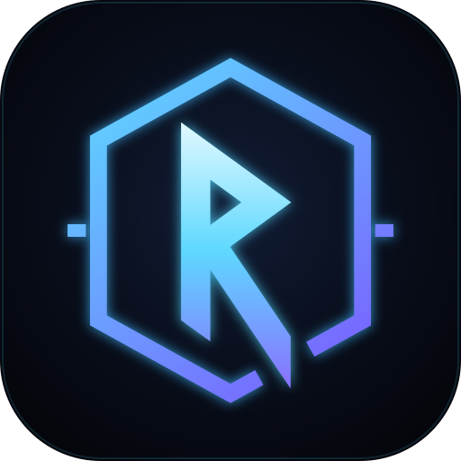
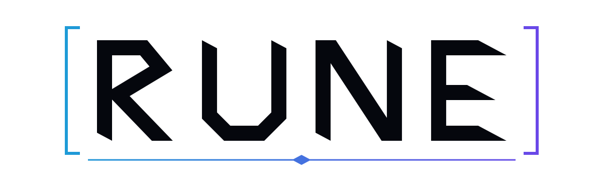

<p align="center">
  
</p>

<h1 align="center">Rune</h1>

<p align="center"><em>Grave ta progression.</em></p>

Rune est une application web installable (PWA) de suivi de musculation, auto-hébergée, pour un cercle privé. Elle proposera des programmes d'entraînement, un suivi des séances qui marche hors ligne, des fiches d'exercices pour débutants, un coach IA au choix et des repères nutrition.

> Rune portait un autre nom de code pendant le cadrage. Tout s'appelle désormais Rune : le dépôt, les paquets (`@rune/…`), le serveur et les scripts. Seuls `docs/superpowers/` et `docs/research/` gardent l'ancien nom, par historique : y lire « rune » partout où un identifiant porte l'ancien nom.

> **Statut : brique 1 (socle) codée, refonte visuelle en cours.** Le socle est fait et relu : comptes sur invitation, onboarding, PWA hors ligne, synchronisation, administration, déploiement, sauvegardes et procédures. Il reçoit en ce moment sa refonte aux couleurs de Rune : thèmes, nouvelle navigation, choix du coach, onglet Progression. **Pas de mise en production avant la fin des cinq briques.** Les spécifications sont dans [`docs/superpowers/specs/`](docs/superpowers/specs/) : la [spec principale](docs/superpowers/specs/2026-10-06-appsport-design.md) et la [spec de la refonte](docs/superpowers/specs/2026-10-13-refonte-rune-design.md).

## Ce que fera l'app

- **Profil selon le contexte** : à l'inscription, chacun indique où il s'entraîne : au poids du corps à la maison, en salle (et laquelle), ou en sport loisir.
- **Un coach au choix**, dès la première étape de l'onboarding :
  - **L'Ombre**, froid et exigeant ;
  - **le Skald**, mentor qui raconte ta saga ;
  - **le Scribe**, calme et précis.

  Au début, il parle par des messages écrits à l'avance. La vraie conversation arrive avec la brique 4.
- **Programmes** adaptés au contexte et au niveau, et **suivi des séances** (séries, répétitions, charges, progression), utilisable hors ligne à la salle.
- **Progression façon RPG** : des rangs de E à S, en pierres runiques, pour le profil et pour chaque groupe musculaire, des quêtes, et un écran LEVEL UP.
- **Bibliothèque d'exercices** pour débutants : visuels, consignes, muscles travaillés, matériel nécessaire.
- **Nutrition** :
  - des repères du jour ;
  - des idées de repas par moment de la journée, avec des options sans gluten et végétariennes ;
  - les pas saisis à la main ;
  - un mode sans chiffres pour qui le préfère.

Public visé : un cercle privé (inscription sur invitation).

## Identité

<picture>
  <source media="(prefers-color-scheme: dark)" srcset="docs/brand/rune-wordmark.svg">
  
</picture>

- **Le nom.** Une rune se grave, comme la progression qu'on note séance après séance.
- **Le logo, « Rang brisé ».** La rune Raidō ᚱ, qui est aussi un R et veut dire « le voyage », est placée dans un badge de rang hexagonal. Sa jambe traverse le cadre et en sort : la progression ne reste pas dans le rang qu'on t'a donné.
- **La palette.**
  - Le noir de nuit `#05070D`.
  - Le bleu glace `#5ED8FF`.
  - Le violet d'éveil `#8C6BFF`, pour les hauts rangs et les récompenses.
  - Le givre `#F2FDFF`.

  Sur les thèmes clairs, le symbole s'affiche en une seule couleur.
- **Les thèmes.** Par défaut, l'appli passe en clair ou en sombre comme le téléphone. On peut aussi forcer Clair ou Sombre, ou choisir l'un des deux thèmes bonus : Carnet (papier crème et encre) ou Salle de nuit (néon et cadres HUD).
- **La typographie.** Chakra Petch pour les titres, les chiffres et les rangs, Barlow pour le texte.

Les fichiers du logo sont dans [`docs/brand/`](docs/brand/).

## Feuille de route

| # | Brique | Contenu |
|---|--------|---------|
| 0 | Vision et architecture | Choix techniques, hébergement, modèle de données |
| 1 | Socle | Comptes sur invitation, onboarding, PWA, déploiement, puis la refonte Rune : thèmes, navigation, choix du coach, Progression en avant-goût |
| 2 | Exercices | Fiches débutant rédigées en français (brouillon IA, relecture humaine), illustrations, recherche par matériel |
| 3 | Programmes et séances | Modèles de programmes, séance en cours, historique, records, progression RPG |
| 4 | Coach IA | Conversation avec le coach choisi, conseils personnalisés, ajustement des programmes |
| 5 | Nutrition | Repères du jour, idées de repas, sans gluten et végétarien, pas du jour |

Chaque brique suit le même cycle : spécification, plan d'implémentation, puis code relu. La mise en production vient après la brique 5.

## Lancer Rune en local (sans Docker)

Il faut Node 24 et pnpm 10. Depuis la racine du dépôt, dans PowerShell ou Git Bash :

```powershell
pnpm install
pnpm dev
```

`pnpm dev` lance ensemble le serveur sur http://localhost:3000 et le web sur http://localhost:5173. Il faut ouvrir http://localhost:5173 : Vite y fait passer `/api` vers le serveur. Les sorties sont préfixées `[serveur]` et `[web]`. Le serveur redémarre à chaque modification de `apps/server/src`, `packages/contracts/src` ou `packages/domain/src`, et le web se recharge tout seul. Ctrl+C arrête les deux. Si le serveur ne démarre pas au lancement (adresse ou port indisponible, base illisible), ou si le web s'arrête en erreur, tout s'arrête et `pnpm dev` sort en erreur. Si le serveur s'arrête en erreur plus tard, après une modification du code, le web reste lancé : la console le dit, et le serveur redémarre à la prochaine modification.

- **Les données de dev** sont hors du dépôt, dans le dossier `rune-data-dev` du dossier personnel (`$HOME\rune-data-dev`). La variable `RUNE_DATA_DIR` en choisit un autre, sauf `rune-data` (celui de la procédure « Comme en production »). Au premier lancement, `pnpm dev` crée le dossier, la sentinelle `.rune-volume`, le repère `.rune-dev` et la base ; ensuite, il ne refait rien. Une base sans le repère `.rune-dev` n'est pas une base de dev : `pnpm dev` refuse de s'en servir.
- **Le lien d'invitation** du premier admin s'affiche dans la console, sur les lignes `[dev]`, tant qu'aucun compte n'existe. Il n'est écrit nulle part ailleurs. Chaque lancement en donne un nouveau, et l'ancien ne marche plus. La date de naissance du compte est factice (`1990-01-01`, ou `RUNE_DEV_BIRTH_DATE`).
- **Pour repartir de zéro**, il faut arrêter `pnpm dev` puis supprimer le dossier `rune-data-dev`.
- **Les ports 3000 et 5173** (ou celui de `RUNE_DEV_WEB_PORT`) doivent être libres : sinon, `pnpm dev` le dit et s'arrête. Le proxy de Vite vise toujours le port 3000 : `pnpm dev` refuse un autre `PORT` (sauf `RUNE_DEV_ANY_PORT=1`, pour les tests).
- **Les variables** déjà définies gagnent sur les valeurs de dev (`APP_ORIGIN`, `PORT`, `HOST`, `RUNE_DATA_DIR`, `RUNE_PUBLIC_DIR`, `RUNE_CONTENT_DIR`). `RUNE_DEV_WEB_PORT` change le port du web (5173 par défaut), et avec lui l'origine par défaut et le lien d'invitation.
- **Après la procédure « Comme en production »**, ses variables restent dans le terminal : il faut lancer `pnpm dev` dans un nouveau terminal, ou les effacer d'abord (`Remove-Item Env:APP_ORIGIN, Env:PORT, Env:HOST, Env:RUNE_DATA_DIR, Env:RUNE_PUBLIC_DIR, Env:RUNE_CONTENT_DIR`).
- **Le service worker** n'existe pas en dev. Si un ancien service worker reste enregistré sur `localhost:5173` (un build servi sur ce port), il faut le désinscrire dans les outils du navigateur (Application, Service workers).

### Comme en production

Pour tester l'appli installable (build du web et service worker), il faut le build et le serveur seul, dans un autre dossier de données. Les commandes ci-dessous sont pour PowerShell, sous Windows.

```powershell
pnpm --filter @rune/web build

$Data = "$HOME\rune-data"
New-Item -ItemType Directory -Force $Data | Out-Null
New-Item -ItemType File -Force "$Data\.rune-volume" | Out-Null
$env:APP_ORIGIN = 'http://localhost:3100'; $env:PORT = '3100'; $env:HOST = '127.0.0.1'
$env:RUNE_DATA_DIR = $Data
$env:RUNE_PUBLIC_DIR = "$PWD\apps\web\dist"
$env:RUNE_CONTENT_DIR = "$PWD\data"

cd apps\server
node --import tsx src/main.ts init                                       # une seule fois : crée la base
node --import tsx src/main.ts admin:bootstrap --birth-date 1990-01-01    # une seule fois : lien d'invitation du premier admin
node --import tsx src/main.ts                                            # démarre Rune sur http://localhost:3100
```

Ensuite, ouvrir le lien d'invitation affiché pour créer le compte admin. Sur téléphone, l'appli installée a besoin du HTTPS : ce sera pour le serveur, derrière Tailscale.

Pour les tests : `pnpm lint`, `pnpm typecheck`, `pnpm test`, `pnpm --filter @rune/web test:e2e` (Chromium et WebKit), et `pnpm test:infra` depuis Git Bash pour les scripts de l'hôte.

## Hébergement

Serveur personnel (16 Go de RAM, 3 To de stockage), joignable par Tailscale à l'adresse `https://rune.<tailnet>.ts.net`. Le déploiement (conteneur Docker, HTTPS, sauvegardes restic chiffrées en local et chez Backblaze B2, supervision) est décrit dans [`docs/exploitation/`](docs/exploitation/). Docker ne sert que sur le serveur, jamais pour développer.

## Crédits

Les fiches d'exercices sont rédigées pour Rune. Illustrations prévues : [everkinetic/data](https://github.com/everkinetic/data) et [bryllim/workout-guide](https://github.com/bryllim/workout-guide) (CC BY-SA 4.0). Le détail des attributions sera tenu à jour dans l'app (page Crédits).
